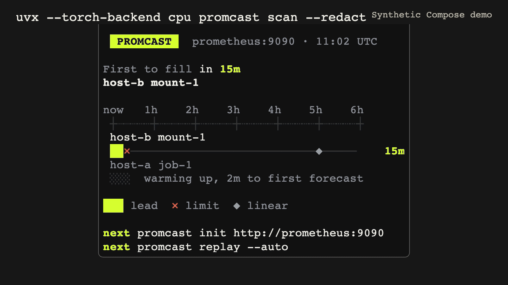

# Promcast

Find the disk that needs attention first.

Promcast reads your Prometheus metrics and lists which disks are likely to fill next, with an estimated time for each. Replay your history to check how much warning you would have had.

<picture>
  <source media="(prefers-reduced-motion: reduce)" srcset="docs/design/social-preview.png">
  
</picture>

**[Explore the demo](https://promcast.intesarjawad.com/)**. It uses a synthetic fleet; the times shown are predictions, not measured warning times from a production incident.

## Install

With Python 3.12 and uv installed, run without cloning:

```sh
uvx --torch-backend cpu --from git+https://github.com/intesarjawad/promcast promcast scan http://localhost:9090
```

The first scan downloads pinned model weights to `~/.cache/promcast/models` and verifies their SHA-256 checksums. Later scans reuse them. Set `PROMCAST_CACHE_DIR` to use another cache; an offline machine needs a copy of the verified model folder there.

## Try it

No Prometheus to hand? Start the local demo with Docker Compose:

```sh
make demo
```

Open [Grafana](http://localhost:3000) to see the synthetic disk scenario. A cold start can take longer than a minute. Check the stack with `make demo-check`, and scan it from the host with `uv run promcast scan http://localhost:9090`. For your own metrics, see [recipes](docs/recipes.md).

## What you get

- **`scan`** discovers the gauges that fill up, such as disks, memory and persistent volumes, and prints the board: what crosses its threshold, and when.
- **`init`** writes the configuration, alert rules and a Grafana dashboard for what it found.
- **`serve`** exposes the forecasts as metrics, so your alerts can fire before the threshold instead of at it.
- **`replay`** runs past forecasts against your own history and shows how early each warning would have come.

## Evidence

Forecasts can be wrong. Validate thresholds and false alerts on your own data before relying on them.

In the synthetic E1 run, toto-2.0-4m caught 4 of 5 incidents and linear extrapolation caught 2, with no false alerts from either. 5 incidents is a smoke test, not an accuracy result. Recall intervals: toto-2.0-4m 0 to 1; linear 0 to 1. The full table is in [evidence](docs/evidence.md).

The image above shows a seeded synthetic fleet, not a production system. `scripts/synthetic_fleet.py` produces its scan results and `scripts/fleet_paths.py` the paths. The gap it shows compares the forecast arrival with `predict_linear` for that one scenario; it is not a general accuracy claim.

The larger runs, E2 BOOM, E3 NAB and E4 homelab, are pending, and no results from them are committed here. `scripts/evidence.py` produces the report when they are.

## Performance

Run `uv run promcast bench --json` to measure forecast cycles on your machine. `scripts/demo_check.sh` measures the local demo; its results depend on the machine and running stack.

## Limits

- Forecasts need enough recent samples. Short histories show as warming up.
- Scan needs local model files and network access to the TSDB.
- Inference runs on the CPU. Intel Macs need Docker, because the pinned torch version has no native wheel there.

More in [recipes](docs/recipes.md), [configuration](docs/config.md) and [architecture](docs/architecture.md). To contribute, clone the repo, run `uv sync --locked` and read [CONTRIBUTING.md](CONTRIBUTING.md).

Licensed under [Apache-2.0](LICENSE).
