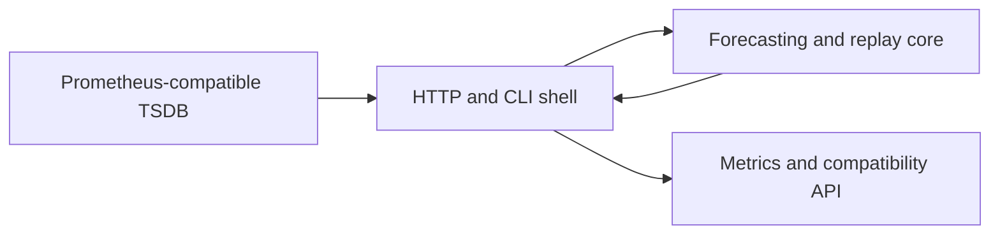

# Architecture

Promcast forecasts Prometheus metrics and serves the forecasts back as metrics.

The boundary separates forecasting and replay calculations from I/O:

Python 3.12, uv and the dependency pins are recorded in `pyproject.toml` and
`uv.lock`. Linux torch uses an explicit CPU index; other dependencies use PyPI.
The optional Chronos comparison is described in
[ADR 0010](adr/0010-chronos-comparison-contract.md).

See [the toolchain decision](adr/0000-toolchain.md).
